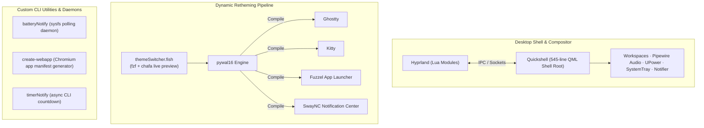

<div align="center">

# Srajan's Dotfiles

### A Modular Wayland Desktop Environment Built with Hyprland, Qt/QML, and Dynamic Theming

[](LICENSE)
[-00A86B.svg)](https://hyprland.org/)
[-41CD52.svg)](https://quickshell.outfoxxed.me/)
[](https://github.com/eylles/pywal16)
[](https://fishshell.com/)

---

A high-performance, keyboard-driven Linux desktop architecture. Rather than an unstructured configuration backup, this repository is engineered as an interconnected, modular desktop ecosystem: custom **Qt/QML layer surfaces**, **Lua-driven compositor rules**, an **on-the-fly cross-application color pipeline**, and **background IPC daemons**.

</div>

---

## 🌟 Architecture & Engineering Highlights



### 1. Custom Qt6/QML Desktop Shell (`quickshell`)
A lightweight, declarative desktop shell written entirely from scratch in **545 lines of QML** using [Quickshell](https://quickshell.outfoxxed.me/):
- **Native Wayland Layer Surfaces**: Hardware-accelerated status capsules with zero Xwayland dependencies.
- **Hyprland IPC Integration**: Real-time workspace indicators and active window tracking responding to compositor events.
- **Hardware & Daemon Bindings**: Declarative integrations for PipeWire (audio/volume), UPower (battery levels & power states), NetworkManager, and Bluetooth services.
- **Built-in System Tray & Notification Daemon**: Custom notification popup engine ([`Notifications.qml`](quickshell/.config/quickshell/Notifications.qml)) designed with modular capsules and auto-dismiss timers.

### 2. Composition-as-Code: Modular Lua Hyprland
Instead of a monolithic `hyprland.conf`, the compositor is structured into isolated, testable Lua modules under [`hyprland/.config/hypr/conf/`](hyprland/.config/hypr/conf/):
- **`monitors.lua` & `workspaceRules.lua`**: Automated window layout assignments and Wayland layer rules.
- **`autostart.lua`**: Controlled daemon lifecycle management (polkit, idle monitoring, cliphist, daemons).
- **`keybindings.lua`**: Fluid ergonomic bindings separating window management from utility scripts.

### 3. Dynamic Automated Theming Pipeline (`pywal16`)
One wallpaper selection synchronizes the visual palette across the entire desktop:
- **Interactive Terminal Selector** ([`themeSwitcher.fish`](customeBashScripts/.local/bin/themeSwitcher.fish)): Uses `fzf` combined with `chafa` to render terminal image previews directly in the shell.
- **Cross-Application Templating**: Passes the image to `pywal16`, instantaneously recompiling stylesheets and templates for:
  - **Ghostty** (`~/.cache/wal/colors-ghostty`)
  - **Kitty** (`~/.cache/wal/colors-kitty.conf`)
  - **Fuzzel** (`~/.config/wal/templates/colors-fuzzel.ini`)
  - **SwayNC** (`~/.config/wal/templates/swaync.css`)

### 4. Custom Daemons & Linux Tooling
Self-authored utility scripts located in [`customeBashScripts/.local/bin/`](customeBashScripts/.local/bin/):
- **`batteryNotify`**: Continuous sysfs monitoring script (`/sys/class/power_supply/BAT0`) with threshold-state tracking (50%, 20%, 10%, 5%) preventing notification storms.
- **`create-webapp`**: Standalone bash tool to convert any web application URL into a first-class desktop citizen with custom desktop entry and icon integration.
- **`timerNotify`**: Headless timer dispatching desktop notifications over DBus upon completion.

---

## ⌨️ Essential Keybindings

| Keybinding | Action | Target / Utility |
|---|---|---|
| <kbd>Super</kbd> + <kbd>T</kbd> | Launch Terminal | Ghostty / Kitty |
| <kbd>Super</kbd> + <kbd>Space</kbd> | Application Launcher | Fuzzel |
| <kbd>Super</kbd> + <kbd>H</kbd> | Dynamic Theme Switcher | `themeSwitcher.fish` (`fzf` + `chafa`) |
| <kbd>Super</kbd> + <kbd>V</kbd> | Clipboard History | `cliphist` + `fuzzel` |
| <kbd>Super</kbd> + <kbd>W</kbd> | Launch Browser | Default Browser |
| <kbd>Super</kbd> + <kbd>E</kbd> | File Manager | File Manager |
| <kbd>Super</kbd> + <kbd>Q</kbd> | Close Window | Active Window |
| <kbd>Super</kbd> + <kbd>P</kbd> | Pseudo-Tiling Toggle | Hyprland Tiling |
| <kbd>Super</kbd> + <kbd>J</kbd> | Toggle Split | Hyprland Layout |
| <kbd>Print</kbd> | Fullscreen Screenshot | `grim` + `swappy` |
| <kbd>Super</kbd> + <kbd>Print</kbd> | Selected Region Screenshot | `slurp` + `grim` + `swappy` |

---

## 📂 Repository Structure

All configurations follow standard [GNU Stow](https://www.gnu.org/software/stow/) conventions:

```text
.
├── quickshell/           # Custom 545-line Qt6/QML desktop shell
├── hyprland/             # Modular Lua compositor configuration
├── pywal16/              # Templating pipeline for cross-app colors
├── customeBashScripts/   # Custom daemons (battery, theme switcher, webapp creator)
├── fuzzel/               # Dynamic-themed Wayland app launcher
├── swaync/               # Notification center CSS styling
├── ghostty/              # Ghostty terminal config
├── kitty/                # Kitty terminal config
├── fish/                 # Interactive shell config, completions & variables
├── fastfetch/            # System fetch telemetry layout
├── animations/           # Terminal ascii & animation utilities
├── repairKit/            # Pacman mirror optimization scripts
└── quickInstall/         # Automated POSIX dependency installers
```

---

## 🚀 Quick Setup & Installation

### 1. Prerequisites (Arch Linux)
Ensure base development and git tools are installed:
```sh
sudo pacman -S --needed git base-devel
```

### 2. Clone the Repository
```sh
git clone https://github.com/SrajanRai45/SrajansDotfiles.git ~/dotfiles
cd ~/dotfiles
```

### 3. Install Packages & Dependencies
Run the automated POSIX installer suite:
```sh
sh quickInstall/setup.sh
```
*(You can also selectively run individual package installers under `quickInstall/<tool>/`)*.

### 4. Deploy Configurations (Symlinking)
Deploy individual modules or the entire desktop suite using **GNU Stow**:
```sh
# Example: deploy compositor, shell, and scripts
stow hyprland
stow quickshell
stow pywal16
stow customeBashScripts
stow fish
stow ghostty
stow kitty
stow fuzzel
stow swaync
```

---

## ⚙️ Path Customization & Environment Variables

All configurations are sanitized with no hardcoded personal paths. You can configure private paths, private repositories, and machine-specific variables using a local `.env` file that is **automatically ignored by Git and never committed to the web**.

### 1. Setting Up Your Local `.env`
Copy the included template to `.env`:
```sh
cp .env.example .env
```
Open `.env` in your editor and configure your private paths:
```sh
# Paths to your private repositories / workspaces
PRIVATE_REPO_DIR="$HOME/Repositories/private-repo"
OBSIDIAN_VAULT_DIR="$HOME/Repositories/obsidian_notes_sync"

# Custom directories
WALLPAPERS_DIR="$HOME/Pictures/Wallpapers"
SCREENSHOTS_DIR="$HOME/Pictures/Screenshots"
```

### 2. Using Variables Across Your Environment

- **In Fish Shell (`fish`)**:
  - Automatically loaded on shell start via [`fish/.config/fish/config.fish`](fish/.config/fish/config.fish#L1-L32).
  - Access any variable as `$PRIVATE_REPO_DIR`, `$WALLPAPERS_DIR`, etc.
  - To add private shell aliases or functions without committing them, create `~/.config/fish/config.local.fish` (ignored by Git).

- **In Custom Bash Scripts (`customeBashScripts`)**:
  - Source the environment loader helper at the top of your scripts:
    ```bash
    [ -f "$HOME/.local/bin/load-env.sh" ] && . "$HOME/.local/bin/load-env.sh"
    cd "$PRIVATE_REPO_DIR"
    ```
  - Or in Fish scripts (like [`themeSwitcher.fish`](customeBashScripts/.local/bin/themeSwitcher.fish#L3-L7)), use `set -q WALLPAPERS_DIR` with a fallback.

- **In Hyprland Compositor (`hyprland`)**:
  - Modular Lua configs under [`hyprland/.config/hypr/conf/variables.lua`](hyprland/.config/hypr/conf/variables.lua#L18-L34) read environment variables via `os.getenv("PRIVATE_REPO_DIR")`.
  - For machine-specific Hyprland binds or settings, create `hyprland/.config/hypr/conf/local.lua` (ignored by Git).

### 3. Other Overrides
- **Pywal Color Linking**:
  - In [`ghostty/.config/ghostty/config.ghostty`](ghostty/.config/ghostty/config.ghostty#L29-L33): uncomment `config-file = ~/.cache/wal/colors-ghostty`
  - In [`kitty/.config/kitty/kitty.conf`](kitty/.config/kitty/kitty.conf#L39-L43): uncomment `include ~/.cache/wal/colors-kitty.conf`
- **Shell Tool Aliases**:
  - In [`fish/.config/fish/config.fish`](fish/.config/fish/config.fish): uncomment aliases for tools you have installed (`eza`, `zellij`, `taskwarrior-tui`, `ryzenadj`).

---

## 📄 License

This repository is distributed under the [MIT License](LICENSE). Feel free to adapt, modify, and build upon any part of the configurations, QML code, or scripts.
